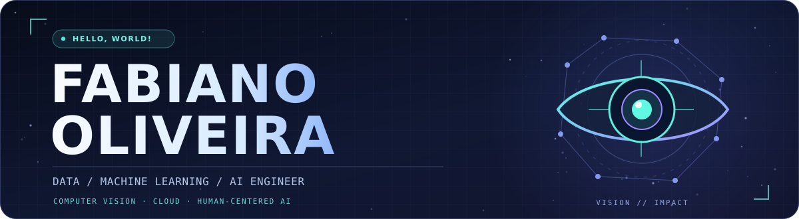
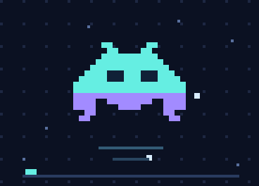

<!--
  FABIANO OLIVEIRA — GitHub Profile README
  Palette: #0B1122 / #65EEE2 / #A28BFF
-->

  

   

  
  
  
  

    

  <code>Building intelligent systems. Making technology more accessible.</code>

---

### 👨‍🚀 About me

I'm a **Data / Machine Learning / AI Engineer** specializing in **Computer Vision**, with a strong background in **Cloud Computing** and **10+ years of hands-on experience in computing**.

My work connects applied research, data-driven engineering, machine learning and production-ready systems. I completed a **Machine Learning residency at the University of São Paulo (USP)**, and I'm especially interested in building AI that helps people interact with the world in new ways.

- 🧠 **Core focus:** Computer Vision, eye tracking, applied ML and intelligent data systems
- ☁️ **Engineering:** cloud platforms, scalable infrastructure, containers and APIs
- 🪐 **Founder & CEO:** [Alnitak AI](https://alnitak.online/)
- 🦁 **Founder:** [New Day Winmont](https://newdaywinmont.site/)
- ▶️ **YouTube Channel:** [Fahik](https://youtube.com/@ImFahik/)
- 🏪 **My Store:** [Fahik Store](https://fahik.store/)
- 🌐 **My Personal Website:** [Fahik Oliveira](https://fahikoliveira.site/)

- 🎯 **What drives me:** turning advanced technology into meaningful accessibility solutions

### 🌌 Featured venture — Alnitak AI

<table>
  <tr>
    <td width="68%" valign="top">
      <h3>AI-powered accessibility through eye tracking</h3>
      

        I founded <b>Alnitak AI</b> to explore how computer vision and eye-tracking technology
        can empower people with quadriplegia and motor conditions such as multiple sclerosis
        to interact with computers, smartphones and televisions using their eyes.
      

      

        Our mission is to make digital independence more accessible by translating eye movements
        into intuitive, hands-free interactions.
      

      

        🏆 <b>2025 UNIFESO Innovative Ideas Award</b> — 2nd place, Student Category (Alnitak Vision AI).
      

      

        <a href="https://alnitak.online/"><b>Explore Alnitak AI ↗</b></a> &nbsp;·&nbsp;
        <a href="https://www.unifeso.edu.br/noticia/index.php?id_not=3610&amp;key=78DD0C06CFB751BA9B38C33E3F8ADA1C0C9E3755"><b>Read the award announcement ↗</b></a>
      

    </td>
    <td width="32%" align="center" valign="middle">
      
       
      <code>&gt; HELLO, HUMAN_</code>
    </td>
  </tr>
</table>

### 🛠️ Tech stack

  
<b>Languages &amp; data</b>

   
  

  
  
  
  
  
  

  
<code>Python</code> · <code>Scala</code> · <code>Julia</code> · <code>R</code> · <code>C++</code> · <code>SQL</code>

  
<b>Machine learning, computer vision &amp; data science</b>

   
  

  
  
  
  
  
  
  
  
  

  
<code>PyTorch</code> · <code>TensorFlow</code> · <code>OpenCV</code> · <code>scikit-learn</code> · <code>Pandas</code> · <code>NumPy</code> · <code>Matplotlib</code> · <code>Seaborn</code>

  
<b>Cloud &amp; infrastructure</b>

   
  

  
  
  
  
  

  
<code>Google Cloud (GCP)</code> · <code>AWS</code> · <code>Docker</code> · <code>Kubernetes</code>

  
<b>Web development &amp; APIs</b>

   
  

  
  
  
  
  
  
  
  
  

  
<code>HTML</code> · <code>CSS</code> · <code>JavaScript</code> · <code>React.js</code> · <code>Node.js</code> · <code>FastAPI</code> · <code>Flask</code> · <code>Django</code>

### ✨ Milestones & credentials

| | Highlight | Details |
| :--: | :-- | :-- |
| 🏆 | **Award-winning innovation — 2025** | [Alnitak Vision AI: 2nd place, UNIFESO Innovative Ideas Award (Student Category)](https://www.unifeso.edu.br/noticia/index.php?id_not=3610&key=78DD0C06CFB751BA9B38C33E3F8ADA1C0C9E3755) |
| 🎓 | **Machine Learning residency — USP** | University of São Paulo |
| ☁️ | **Google Cloud learning credentials** | [View my public Google Cloud Skills profile](https://www.skills.google/public_profiles/d6efd537-fa3b-4041-b075-601d96a03904) |

### 🚀 Areas I love building in

| 👁️ **Computer Vision** | 🧬 **Applied AI / ML** | ☁️ **Cloud Engineering** |
| :-- | :-- | :-- |
| Eye tracking, real-time vision and human-computer interaction | ML pipelines, data systems, model development and experimentation | Cloud-native services, container orchestration and scalable APIs |

---

  <h3>Let's build something that matters.</h3>
  
Interested in AI, accessibility, computer vision or cloud engineering?

  
    
  Made with purpose, curiosity and a little bit of pixel art. 🛸

